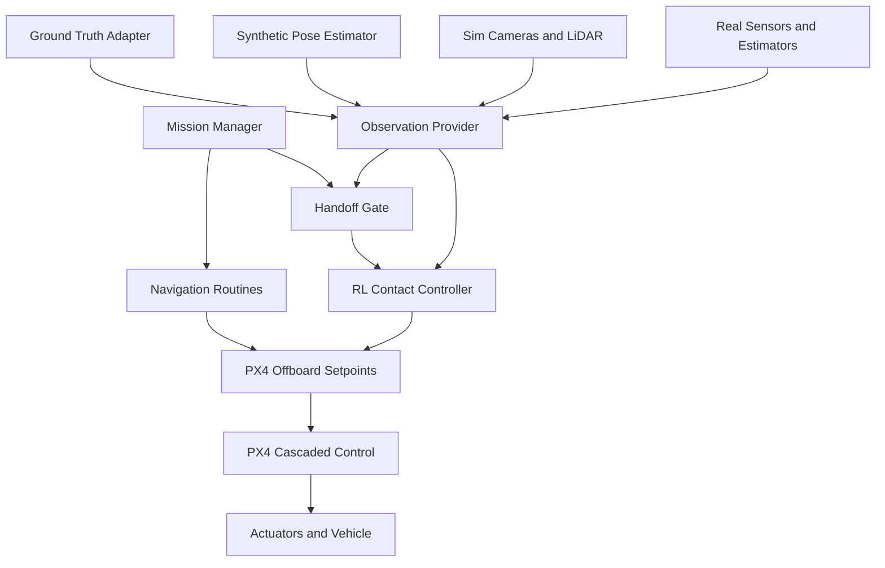
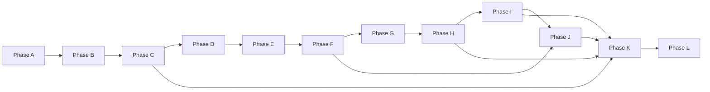

# LIGHT_SWITCH_MULTIROTOR_ROADMAP

## Executive summary

This roadmap proposes a deliberate separation between **flight stabilization**, **global navigation**, **state estimation/perception**, and **local contact manipulation**. The central architectural decision is that the **RL contact controller should be trained before full camera-based perception is integrated**, but it must **never** read simulator internals directly. Instead, it should consume a stable **Observation Interface** whose early values come from ground truth routed through synthetic sensor/provider channels, then progressively from a noisy synthetic pose estimator, then from simulated cameras/LiDAR, and only later from real sensors. That ordering matches both PX4’s cascaded control model and the way modern robot-learning stacks such as Isaac Lab factor observations, rewards, curriculum, and randomization into distinct managers. It also reflects the contact-control literature in aerial manipulation, which repeatedly shows that physical interaction is its own control problem and that stable contact depends heavily on compliant interaction and force-aware estimation, not only on perception quality. citeturn9view0turn8view4turn16view1turn16view2turn14view3turn14view4turn15view4

The practical consequence is simple. The project should not jump directly from navigation to simulated RGB-D perception to RL. It should first define a **production observation contract**, train the RL controller on that contract under idealized conditions, then harden the controller by introducing realistic estimator failure modes: noise, delay, bias, dropouts, confidence erosion, and rare outliers. This is consistent with sim-to-real practice in robotics, where dynamics/domain randomization improves robustness, and with curriculum methods that improve learning by sequencing problems from easier to harder rather than requiring the agent to solve the full problem immediately. citeturn15view0turn15view1turn14view1turn15view2turn15view3

For this specific mission, the RL policy’s job is intentionally narrow: **the last decimeters of approach, first contact, compliant pressing, confirmation, and retreat**. PX4 keeps the high-rate inner-loop stabilization and control allocation, while a mission manager decides when to enter or exit contact mode. The policy therefore consumes relative switch pose, body velocity, angular rates, pusher compression, contact state, lamp confirmation, and explicit validity/staleness/confidence fields. The most important fields for staged perception are `pose_confidence`, `pose_age_ms`, and `detection_valid`, because they make it possible to test handoff logic before image pipelines are present. citeturn8view4turn10view0turn10view1turn16view1

The remainder of this document is written as a consolidated, production-ready canonical roadmap. It defines the target objective, the system architecture, the Observation Interface, phased sensor integration, staged RL curricula, domain-randomization policy, implementation phases A–L, handoff criteria, evaluation metrics, sim-to-real gates, risks, and appendices with recommended noise models and an example observation schema. The emphasis throughout is on clear contracts, reproducible configuration, and reversible implementation decisions. citeturn16view1turn16view2turn7view6turn8view5

## Objective and system architecture

### Objective

The objective is to build a PX4-based multirotor system that can:

1. take off and stabilize;
2. navigate to a roughly known switch location;
3. localize a wall switch and estimate its relative pose;
4. hand off from navigation to a local contact controller only when the estimate is valid and fresh;
5. make stable wall contact using a compliant pusher;
6. depress the switch with sufficient force/travel to toggle the linked lamp state;
7. verify success through lamp-state change;
8. retreat safely and either continue the mission or abort according to policy. citeturn8view4turn9view0turn14view3turn15view4

This decomposition follows the logic of PX4’s cascaded architecture. PX4’s multicopter stack uses a standard cascaded controller in which EKF2 supplies state estimates, the outer position loop commands velocity, the velocity loop commands acceleration, and lower layers handle attitude, rate, and control allocation. Offboard mode allows an external controller to provide position, velocity, acceleration, attitude, body-rate, or thrust/torque setpoints, but PX4 still expects explicit keepalive/proof-of-life signaling and failsafes if that signaling is lost. That makes PX4 the right place to keep the high-rate flight-control problem, while the project-specific logic above it handles navigation and contact behavior. citeturn9view0turn8view4turn8view5

The architecture also matches aerial-interaction results in the literature. Aerial contact tasks are sensitive to contact force, compliance, and disturbance rejection; successful systems therefore tend to rely on some combination of passivity/impedance/admittance control, force or wrench estimation, and hybrid pose/force objectives rather than naïve free-space trajectory tracking. For example, Yüksel et al. addressed aerial physical interaction with passivity-preserving control and wrench sensing/observation, while Tzoumanikas et al. built a hybrid force/position NMPC for aerial writing, and Malczyk et al. showed that interaction-force estimation materially improves robust push/slide operations under disturbance. Those results strongly support treating the switch press as a distinct **contact-control** problem from the beginning. citeturn14view3turn15view4turn15view5turn14view4

### Canonical control boundaries

The production architecture should use the following control boundaries:

- **PX4** owns state estimation fusion, cascaded stabilization, attitude/rate control, and actuator allocation. citeturn9view0turn10view0
- **Navigation routines** own takeoff, hover, world-frame transit, pre-contact approach, and retreat target generation. citeturn8view4turn9view0
- **Observation provider** owns transformation of all upstream data into the normalized policy-facing observation contract. In early phases this provider may use simulator ground truth internally; later it will fuse simulated or real sensors. Isaac Lab’s manager-based workflow is well aligned with this separation because observations, curriculum, and randomization are explicit configuration layers. citeturn16view1turn16view2turn7view6
- **RL contact controller** owns only local approach refinement, first touch, compliant press, success confirmation, and retreat initiation once the handoff gate is satisfied. It does not own global navigation and it does not ingest raw simulator internals. citeturn8view4turn16view1
- **Mission manager** owns sequencing, retries, timeouts, aborts, and switching among navigation, search, contact, retreat, and landing modes. citeturn8view4turn8view5

The resulting system should be viewed as a hierarchy, not as one monolithic policy.



This architecture is preferable to an end-to-end image-to-motor policy for three reasons. First, PX4 already supplies a mature stabilized control core with strict offboard semantics and failsafes. Second, Isaac Lab explicitly supports structured observations, events, curriculum, and RL task definitions, which makes a swappable observation-provider layer natural rather than ad hoc. Third, contact-rich aerial manipulation papers consistently center force-aware local interaction, not end-to-end perception as the primary control challenge. citeturn8view4turn9view0turn16view1turn16view2turn14view3turn14view4turn15view4

### Recommended software layering

The software should be organized into five layers:

| Layer | Responsibility | Primary inputs | Primary outputs |
|---|---|---|---|
| PX4 runtime | EKF, mode logic, cascaded control, failsafes | IMU, range, flow, external vision, offboard commands | stabilized flight, actuator commands |
| Vehicle routines | takeoff, goto, hover, staged approach, retreat | mission commands, local state | offboard trajectory or velocity targets |
| Observation provider | normalize and publish policy observations | ground truth, synthetic estimator, simulated sensors, real sensors | observation tensor / dataclass |
| RL contact controller | local contact policy | normalized observations | local velocity / pose-rate commands |
| Mission manager | sequencing, retries, aborts, search policy | planner state, gate status, policy outcomes | routine transitions and mode changes |

The table above is a design recommendation, but each boundary is grounded in the interfaces offered by PX4 and Isaac Lab. PX4 explicitly distinguishes externally provided offboard setpoints from its internal control pipeline and warns that external publishers must write only the setpoints they own. Isaac Lab correspondingly encourages configuration-based separation of observations, actions, rewards, events, and curricula. citeturn8view5turn16view1turn16view2

## Observation interface and handoff gate

### Observation Interface principles

The Observation Interface is the most important artifact in this roadmap. It is the contract that allows the project to start with perfect information and later integrate imperfect sensors without rewriting the policy. The key rule is:

> **The policy observes normalized task-relevant state, not raw sensors and not simulator internals.**

That rule is consistent with Isaac Lab’s observation-manager abstraction and with PX4’s use of fused state topics such as `VehicleLocalPosition`, which already package validity flags, timestamps, positions, velocities, and uncertainties in a control-oriented form rather than exposing raw sensor packets. citeturn16view1turn7view6turn10view1

The local vehicle/body frame in PX4 is FRD/NED oriented, while task execution near the wall benefits from a **local contact frame**. The cleanest approach is therefore:

- maintain PX4 estimation in NED/FRD as designed; citeturn10view0turn10view1
- transform switch-relative geometry into a task-local frame for the policy;
- expose both the transformed value and enough metadata for sanity checking.

The recommended contact frame is:

- **x**: wall-normal press axis pointing from drone toward switch surface;
- **y**: tangent axis along the plate’s horizontal direction;
- **z**: tangent axis along the plate’s vertical direction.

This frame is a project-level design choice, but it aligns with contact-control practice, where expressing interaction in a surface-relative frame simplifies force/pose reasoning. citeturn14view3turn15view4turn14view4

### Canonical observation fields

The table below defines the canonical Observation Interface. Update rates are recommended values for the **policy-facing provider**, not necessarily the native sensor rates. They are chosen to match PX4’s stabilized lower layers, PX4’s external-vision fusion guidance, and the practical need to avoid starving the policy with stale data while keeping the contract simple and reproducible. PX4 recommends streaming external-vision messages to EKF2 at roughly 30–50 Hz, and `VehicleLocalPosition` explicitly defines validity flags, timestamps, velocities, and uncertainty terms that map naturally into this interface. citeturn10view0turn10view1turn8view4

| Field | Type | Units | Frame | Recommended rate | Required | Description |
|---|---|---:|---|---:|---|---|
| `timestamp_ms` | int64 | ms | monotonic | every policy step | yes | provider timestamp |
| `policy_dt_ms` | float32 | ms | n/a | every policy step | yes | actual interval since previous obs |
| `relative_switch_pos_m` | float32[3] | m | contact frame | 30–50 Hz | yes | switch/button origin relative to pusher reference |
| `relative_switch_quat_xyzw` | float32[4] | unitless | contact frame | 30–50 Hz | yes | switch orientation |
| `pose_confidence` | float32 | [0,1] | n/a | 30–50 Hz | yes | confidence score from provider |
| `pose_age_ms` | float32 | ms | n/a | every policy step | yes | age of latest accepted pose sample |
| `detection_valid` | bool | n/a | n/a | every policy step | yes | whether the pose sample is usable |
| `body_lin_vel_mps` | float32[3] | m/s | body FRD | 50–100 Hz | yes | current body-frame linear velocity |
| `body_ang_vel_radps` | float32[3] | rad/s | body FRD | 50–100 Hz | yes | current angular velocity |
| `attitude_quat_xyzw` | float32[4] | unitless | body→world | 50–100 Hz | yes | filtered attitude |
| `pusher_compression_m` | float32 | m | press axis | 100 Hz | yes | spring/damper compression; force proxy |
| `pusher_compression_rate_mps` | float32 | m/s | press axis | 100 Hz | preferred | derivative for damping awareness |
| `contact_valid` | bool | n/a | n/a | every policy step | yes | whether contact estimate is considered trustworthy |
| `contact_flag` | bool | n/a | n/a | 50–100 Hz | yes | binary wall/tool contact |
| `lamp_state` | int8 | enum | n/a | 5–20 Hz | preferred | -1 unknown, 0 off, 1 on |
| `lamp_confidence` | float32 | [0,1] | n/a | 5–20 Hz | preferred | confidence in lamp state |
| `lamp_age_ms` | float32 | ms | n/a | every policy step | preferred | staleness of lamp estimate |
| `previous_action` | float32[k] | normalized | n/a | every policy step | yes | prior policy command |
| `handoff_mode` | int8 | enum | n/a | every policy step | optional | 0 nav, 1 precontact, 2 contact |
| `estimator_health` | float32 | [0,1] | n/a | 10–50 Hz | preferred | aggregate provider health |
| `obs_mask` | uint32 | bitmask | n/a | every policy step | preferred | indicates present/missing optional fields |

### Field definitions and units

`relative_switch_pos_m` and `relative_switch_quat_xyzw` are the core task variables. They define where the policy believes the switch is. Early on, these come from the ground-truth adapter. Later, they come from a synthetic pose estimator, then from simulated RGB-D/LiDAR perception, then from real detectors and estimators. The policy must not know which provider produced them. That provider swap is the entire reason the roadmap starts with a stable interface. citeturn16view1turn16view2turn16view0turn7view7

`pose_confidence`, `pose_age_ms`, and `detection_valid` are mandatory because they turn perception uncertainty into explicit control-state logic instead of hidden failure. PX4 already encodes similar concepts in its state-estimation stack through validity flags, timestamps, and innovation-based gating. `VehicleLocalPosition` includes timestamps and validity flags, while EKF2 explicitly performs confidence checks on observations and logs position/velocity innovations and failures. Those PX4 patterns should be mirrored in the mission-level observation contract even though the exact fields are project-specific. citeturn10view1turn11view4

`pusher_compression_m` is mandatory because the literature on aerial physical interaction consistently shows that interaction force or force-proxy information matters in contact. Even systems that do not use a dedicated force sensor often rely on wrench observers, interaction-force estimators, or compliance-aware control to distinguish intentional contact from disturbance. For a light-switch task, pusher compression is a practical low-cost substitute for a full wrench estimate and should therefore remain part of the contract from simulation through real hardware. citeturn14view3turn14view4

`lamp_state`, `lamp_confidence`, and `lamp_age_ms` are included even if some stages do not use a camera-based lamp detector yet. In simulation, lamp state can come directly from the environment model; later it can come from a light-state classifier or brightness-change detector. Including these fields early prevents the policy and mission manager from being rewritten when the confirmation mechanism changes. That mirrors the same swap-friendly philosophy used for pose estimation. citeturn16view1turn16view0

### Recommended policy rates

The recommended **policy inference rate** is **20 Hz initially**, then **30–50 Hz** once the observation provider is stable. This is a design inference rather than a verbatim specification from any single source, but it follows directly from three facts: PX4 keeps the high-rate stabilization internally; PX4 expects reliable offboard keepalive/proof-of-life and supports external setpoints at motion-control layers; and EKF2 external-vision fusion is guided toward roughly 30–50 Hz. As a result, the policy does not need to run at IMU rate, but it also should not be slower than the pose and contact dynamics near the wall. citeturn8view4turn8view5turn10view0turn9view0

### Handoff gate criteria

The handoff gate is mission-critical. It decides when the navigation stack is allowed to transfer control authority to the RL contact controller. The gate exists because PX4 offboard control is explicit about health/keepalive semantics, and because aerial-interaction papers show that unstable or poorly estimated initial contact conditions degrade interaction performance dramatically. citeturn8view4turn14view3turn14view4

A recommended initial handoff gate is:

| Criterion | Initial threshold | Mature threshold | Notes |
|---|---:|---:|---|
| `detection_valid` | true | true | hard requirement |
| `pose_confidence` | ≥ 0.85 | ≥ 0.90 | lower only for controlled experiments |
| `pose_age_ms` | ≤ 100 ms | ≤ 60 ms | tighter once sensor stack is stable |
| switch range | ≤ 0.35 m | ≤ 0.25 m | distance from pusher to switch origin |
| lateral alignment error | ≤ 0.08 m | ≤ 0.03 m | in contact-frame y/z |
| wall-normal velocity | ≤ 0.15 m/s | ≤ 0.08 m/s | must be slow before handoff |
| lateral velocity magnitude | ≤ 0.20 m/s | ≤ 0.10 m/s | reduces first-touch shear |
| angular-rate magnitude | ≤ 0.40 rad/s | ≤ 0.20 rad/s | avoids rotational contact shocks |
| estimator health | ≥ 0.80 | ≥ 0.90 | aggregate provider score |
| lamp state freshness | optional | ≤ 300 ms | only if policy uses lamp confirmation online |

The exact thresholds will need tuning, but the structure should remain fixed. A handoff gate should never depend only on “switch detected yes/no.” It must also enforce **freshness**, **confidence**, **relative geometry**, and **kinematic calmness**. This is one of the places where the synthetic pose estimator stage creates immediate value: it allows the team to validate the gate and the retry/abort logic before any simulated image pipeline exists. citeturn10view0turn10view1turn11view4

### Example handoff pseudocode

```python
def handoff_ready(obs) -> bool:
    if not obs["detection_valid"]:
        return False
    if obs["pose_confidence"] < 0.90:
        return False
    if obs["pose_age_ms"] > 60.0:
        return False

    px, py, pz = obs["relative_switch_pos_m"]
    lateral_err = (py**2 + pz**2) ** 0.5
    vx, vy, vz = obs["body_lin_vel_mps"]
    wx, wy, wz = obs["body_ang_vel_radps"]

    if px > 0.25:
        return False
    if lateral_err > 0.03:
        return False
    if abs(vx) > 0.08:
        return False
    if (vy**2 + vz**2) ** 0.5 > 0.10:
        return False
    if (wx**2 + wy**2 + wz**2) ** 0.5 > 0.20:
        return False

    return True
```

## Sensor stages and RL curricula

### Sensor-stage roadmap

The sensor pipeline should be implemented in four stages. This ordering is the project’s clearest response to the question that drove the conversation: **yes, the drone will rely heavily on sensors during real contact work, but no, that does not mean full sensors should be the first dependency of RL**. The right dependency is the observation contract, not the final perception stack. PX4 already supports fusion of external vision/VIO/MoCap data into EKF2, and Isaac Lab already supports explicit camera and lidar sensors plus modular observation handling. That makes staged providers technically natural. citeturn10view0turn16view0turn7view7turn16view1

#### Ground-truth provider stage

In the first stage, the observation provider internally queries simulator truth and publishes policy observations with **no perceptual uncertainty**. This is not “cheating the policy,” because the policy only sees the normalized observation fields, not simulator internals. This stage exists to teach the contact controller the structure of the task: align, touch, build compression, depress, detect success, and retreat. citeturn16view1turn16view2turn15view4

#### Synthetic pose estimator stage

In the second stage, the ground-truth pose is passed through a synthetic estimator that injects noise, latency, bias, missing detections, and rare gross errors. The interface remains identical:

```text
ground truth pose
    -> synthetic estimator
    -> normalized observation provider
    -> policy
```

This stage is the correct bridge before cameras. It validates navigation-to-contact handoff, controller robustness to staleness and uncertainty, and retry/abort logic before the team simultaneously debugs rendering, camera calibration, detection models, synchronization, and estimator fusion. That approach is directly aligned with curriculum and domain-randomization principles from sim-to-real RL. citeturn15view0turn15view1turn15view2turn15view3

#### Simulated cameras and LiDAR stage

In the third stage, the system begins publishing observations from simulated sensors. Isaac Lab’s camera stack supports render-product-based camera sensors with configurable pose/intrinsics and annotators for RGB, depth, segmentation, object pose, and object ID, while Isaac Sim’s RTX lidar is rendered on the GPU at render time. Those capabilities are sufficient to build a realistic switch detector and relative-pose estimator before hardware deployment. citeturn16view0turn7view7

This stage should also model the device family intended for real deployment. The Intel RealSense D435i family can provide depth up to 90 fps at selected resolutions, while the RPLIDAR A2 advertises sampling up to 8000 samples per second. PX4 also supports PMW3901-class optical-flow sensors and external vision/odometry fusion in EKF2, which makes the eventual sim-to-real routing clear even if the early provider bypasses raw sensors. citeturn7view3turn7view4turn2search2turn2search6turn10view0

#### Real-sensor stage

In the fourth stage, the synthetic and simulated providers are replaced by real sensors and estimators. PX4’s external-vision documentation is especially relevant here: EKF2 prefers visual-odometry messages and recommends streaming them at roughly 30–50 Hz to ensure fusion. That guidance should shape both the real estimation stack and the rates expected by the observation provider. citeturn10view0

### Sensor-stage comparison table

| Stage | Provider | Purpose | Policy API change | Typical failure modes introduced |
|---|---|---|---|---|
| Ground truth | simulator truth adapter | learn clean contact mechanics | none | none or minimal quantization |
| Synthetic estimator | truth + stochastic errors | validate staleness, confidence, retries | none | noise, bias, delay, dropout, outliers |
| Sim sensors | RGB-D/LiDAR/flow + estimator | validate rendering, detector, fusion | none | calibration drift, occlusion, detector failure |
| Real sensors | physical devices + PX4/companion fusion | deployment and acceptance | none | lighting, vibration, thermal drift, wiring, EMI |

The invariant across all four stages is the phrase **“policy API change: none.”** That is the contract the whole roadmap is designed to protect. citeturn16view1turn16view2

### Stabilization curriculum

Before training the policy to press a switch, it should learn constrained interaction. This is the **drone stabilization curriculum** discussed in the conversation. The literature supports this sequencing indirectly: aerial interaction becomes dramatically harder once contact forces and environment constraints are present, and successful controllers emphasize preserving stable interaction under disturbance rather than treating contact as a trivial extension of free flight. citeturn14view3turn14view4

The curriculum should proceed as follows:

| Stage | Environment | Goal | Exit condition |
|---|---|---|---|
| Free-space hover | no wall, no switch | stable hover near target frame | low position/rate error for fixed horizon |
| Wall approach | rigid wall, no switch | approach until first touch, then retreat | controlled contact without rebound |
| Stable wall contact | wall only | maintain gentle contact for increasing duration | bounded oscillation and compression |
| Wall contact with orientation randomization | wall tilt ±10–20°, varying touch point | generalize stable constrained hover | success across pose/contact distribution |
| Large compliant switch | oversized, soft, low-force switch | introduce press while preserving stability | consistent press/release cycles |
| Realistic switch | nominal geometry and stiffness range | full press behavior | nominal task success at target metrics |

The critical addition is the fourth stage: randomized wall orientation, surface location, and target contact force. Without it, the controller can memorize a single perpendicular wall approach and fail when real geometry shifts. That recommendation is a design inference, but it follows the same reasoning as environment/domain randomization in sim-to-real robotics. citeturn15view0turn15view3

### Contact curriculum

The contact curriculum should explicitly manipulate the task parameters the conversation identified: switch size, press force, travel, stiffness, pose noise, handoff distance, wall friction, and drone mass/latency. This structure follows curriculum-learning logic—solve an easier task first, then tighten toward reality—and sim-to-real logic—expand the training distribution after the nominal behavior is learned. citeturn15view2turn15view3turn15view0

| Curriculum stage | Switch size | Press force | Travel | Stiffness | Pose noise | Handoff distance | Wall friction | Drone mass / latency | Primary purpose |
|---|---|---|---|---|---|---|---|---|---|
| Easy contact | 1.5–2.0× nominal | 0.3–0.5× nominal | 0.5× nominal | soft | none | very close | forgiving | nominal | discover basic sequence |
| Real geometry, easy actuation | 1.0× nominal | 0.4–0.6× nominal | 0.7× nominal | soft–medium | none | close | forgiving | nominal | remove spatial crutch |
| Nominal geometry, rising load | 1.0× nominal | 0.6–0.9× nominal | 0.8–1.0× | medium | low | moderate | nominal | slight randomization | build press authority |
| Noisy perception | 1.0× nominal | 0.8–1.0× nominal | 1.0× | nominal | moderate | moderate | nominal | mild latency randomization | learn estimator robustness |
| Randomized contact | 0.9–1.1× | 0.8–1.2× | 0.9–1.1× | wide range | moderate + outliers | moderate | broad range | broad range | robustness and transfer |
| Acceptance distribution | real-world measured | real-world measured | real-world measured | measured | real-estimated | deployment | measured | measured | final validation only |

This table should be implemented as actual configuration, not as aspirational prose. The curriculum parameters belong in versioned config files, and each stage should have explicit promotion criteria. That recommendation is consistent with Isaac Lab’s manager/event/curriculum model, which is intended for reproducible environment variation rather than hidden script logic. citeturn16view1turn16view2turn7view6

### Reward design recommendations

The reward model should reflect the curriculum and should avoid rewarding merely “touching the wall.” A good initial reward composition is:

- alive/stable hover term;
- approach-improvement term before contact;
- gentle-contact term after first touch;
- compression-progress term while aligned;
- displacement/actuation term tied to switch travel;
- one-time success reward tied to lamp-state confirmation;
- retreat reward after success;
- smoothness/energy penalties throughout;
- penalties for high-rate oscillation, scraping, sustained misalignment, and timeout.

This recommendation is motivated by the task structure rather than a single cited source, but it is consistent with Isaac Lab’s explicit reward-term configuration model and with the aerial-interaction literature’s emphasis on stable force/pose transitions rather than binary contact alone. citeturn16view2turn14view3turn15view4

### Important anti-patterns

The roadmap should explicitly reject four anti-patterns.

First, do not train the policy directly on raw camera images at the outset. The camera stack is a separate integration risk, and Isaac Lab’s own documentation acknowledges the bandwidth and scaling cost of camera data. Use cameras to produce estimates; feed the policy estimates. citeturn16view0

Second, do not let the policy read USD/state internals directly. Those reads are acceptable inside reward/evaluation code and inside synthetic providers, but not inside the policy-facing API. Isaac Lab’s observation-manager structure exists precisely to prevent that leakage. citeturn16view1turn7view6

Third, do not overfit the curriculum to an oversized switch by rewarding generic plate contact. Reward should be tied to intended actuation and confirmation. This is a project recommendation, but it follows naturally from the task objective and from curriculum logic. citeturn15view2turn15view3

Fourth, do not hand off to RL based only on target visibility. Freshness, confidence, calmness, and geometry all matter, and PX4 offboard behavior is explicit about the consequences of stale or missing upstream control signals. citeturn8view4turn8view5turn10view0

## Domain randomization and implementation phases

### Domain-randomization strategy

The project should use **curriculum-coupled domain randomization**, not one-shot maximal randomization from day one. Peng et al. showed that varying simulator dynamics can produce policies that generalize to substantially different real-world dynamics without on-robot training, while the dexterous-manipulation work from OpenAI used broad randomization of physical and visual properties to transfer from simulation to hardware. SS-ADR then generalized that intuition by showing practical benefits from co-evolving environment difficulty with task difficulty rather than treating randomization as static noise. citeturn15view0turn15view1turn14view1turn15view2turn15view3

That suggests a three-layer randomization policy for this roadmap:

1. **Nominal learning zone**
   Narrow ranges around the expected real platform. Used to learn the base behavior.

2. **Expansion zone**
   Gradually widened ranges on the dimensions that matter for transfer: mass, latency, wall friction, pusher stiffness, switch force, estimator delay, visual texture, lighting, and detector noise. Used once stable behavior exists.

3. **Acceptance zone**
   Fixed evaluation distributions measured from the actual platform and environment. Used only for validation, not for shaping. citeturn15view0turn14view1turn15view3

A practical randomization matrix is:

| Category | Parameters to randomize | Stage introduced |
|---|---|---|
| Vehicle dynamics | mass, inertia, motor lag, thrust scale, hover thrust bias | contact stage onward |
| Contact mechanics | pusher stiffness/damping, contact restitution, wall friction | stabilization stage onward |
| Task geometry | switch pose, plate size, switch depth, wall tilt, stand-off target | early curriculum onward |
| Estimation | Gaussian pose noise, bias, delay, dropouts, outliers, confidence scaling | synthetic estimator stage |
| Visual scene | lighting, shadows, exposure, texture, clutter | simulated sensors stage |
| Sensor intrinsics/extrinsics | camera focal length, depth bias, camera pose offsets, lidar timing | simulated sensors stage |
| Confirmation channel | lamp brightness, camera exposure, false negatives | noisy-sensor stage onward |

Each randomized parameter should have a configuration record with: name, units, nominal value, current training range, acceptance range, sampling law, stage introduced, and seed behavior. This is the minimum needed for reproducibility. Isaac Lab’s event/randomization model is directly suited to this style of configuration-driven randomization. citeturn16view1turn7view6

### Implementation phases

The roadmap should formally adopt phases A–L in the following order.

| Phase | Name | Core deliverable | Exit gate |
|---|---|---|---|
| A | Runtime and PX4 bridge | deterministic SITL/runtime loop, offboard command path, logging | stable takeoff/hover/land demos |
| B | Airframe assets and propulsion configs | X4 baseline assets, later X8 option, measured dynamics placeholders | physically plausible hover and transit |
| C | Navigation routines | arm, takeoff, goto, hover, retreat, approach primitives | repeatable pre-contact positioning |
| D | Switch, lamp, and pusher environment | articulated switch, lamp latch, contact geometry, wall variants | deterministic switch toggling by scripted controller |
| E | Hardware-faithful dynamics | measured or estimated mass/inertia, pusher compliance, actuator latency | simulation tracks bench/flight logs adequately |
| F | Observation interface and provider layer | normalized policy contract, provider abstraction, schemas, logging | policy input stable and versioned |
| G | Stabilization curriculum | free-space hover to stable wall-contact tasks | policy holds stable contact under random wall pose |
| H | Contact curriculum | staged switch actuation under increasing realism | nominal switch-press success in synthetic observations |
| I | Synthetic pose estimator | noisy/delayed/dropout pose provider with confidence and age | handoff/retry logic validated |
| J | Simulated sensors and fusion | RGB-D/LiDAR/flow simulation and estimator chain | same policy works with sim-perception provider |
| K | Mission manager | sequencing, retries, aborts, watchdogs, safety transitions | one complete mission loop in sim |
| L | Autonomous discovery and real-sensor deployment | wall scanning, target discovery, real sensors, sim-to-real acceptance | hardware validation and mission demonstrations |

This is the crucial reorder from the earlier plan. The policy is no longer blocked on “full sensor integration.” It is blocked only on Phase F, because the policy needs an observation channel, not an image stack. That is the architectural correction the conversation converged on. It is supported by PX4’s offboard model, Isaac Lab’s manager abstractions, and sim-to-real practice in robotics. citeturn8view4turn16view1turn16view2turn15view0turn14view1

### Phase timeline

The timeline below is an illustrative dependency graph rather than a calendar promise.



A compact planning view is:

| Milestone band | Dominant phases | What must be true |
|---|---|---|
| Foundation | A–E | vehicle flies stably and environment is credible |
| Interface first | F | all future policy/sensor work uses one observation contract |
| RL first pass | G–H | policy solves contact under idealized observations |
| Estimation hardening | I | policy and mission manager are robust to imperfect pose |
| Sensor realism | J | observation provider can swap to simulated cameras/LiDAR |
| Mission closure | K–L | complete autonomous loops, then real-sensor transfer |

### Design principles

The roadmap should adopt the following non-negotiable design principles:

1. **Policies consume observations, not simulator internals.** citeturn16view1turn7view6
2. **Observation providers are swappable and versioned.** citeturn16view1turn16view2
3. **PX4 remains the owner of high-rate stabilization and actuator control.** citeturn9view0turn8view4
4. **Mission logic owns handoff, retries, and aborts; the policy does not self-schedule missions.** citeturn8view5
5. **Curriculum precedes large-domain randomization; acceptance evaluation uses real-world distributions.** citeturn15view0turn15view3
6. **Camera simulation is an integration phase, not an RL prerequisite.** This is an architectural inference supported by the project boundaries and the sources above. citeturn16view0turn16view1turn15view0
7. **Contact success is defined by actuation and confirmation, not by generic wall contact.** citeturn14view3turn15view4
8. **Every stochastic element must be config-driven and seedable.** citeturn16view1turn7view6

## Testing, evaluation, and risk management

### Testing and evaluation plan

Testing should proceed in layers that mirror the architecture.

At the **provider layer**, each observation field should be unit-tested for frame, units, default behavior, missing-data behavior, and logging integrity. PX4’s own state topics illustrate why this matters: validity flags and timestamps are as important as the numerical states themselves. citeturn10view1

At the **controller layer**, the RL contact controller should be evaluated first under deterministic conditions, then under controlled stochastic stress. Key metrics should include:

| Metric | Definition | Initial target | Mature target |
|---|---|---:|---:|
| handoff acceptance rate | % of valid pre-contact situations accepted by gate | ≥ 95% in nominal sim | ≥ 95% with synthetic noise |
| false handoff rate | % of unsafe/stale situations incorrectly accepted | ≤ 2% | ≤ 1% |
| first-contact stability | % of contacts without rebound/oscillation abort | ≥ 85% | ≥ 95% |
| press success rate | % of trials that toggle switch within timeout | ≥ 80% | ≥ 95% nominal, ≥ 85% randomized |
| post-success retreat rate | % of successful toggles followed by safe retreat | ≥ 95% | ≥ 99% |
| median time-to-toggle | first policy action to lamp confirmation | track only | improve without raising failure rate |
| peak compression overshoot | max compression above required actuation | bounded | reduced over time |
| contact oscillation metric | RMS lateral velocity/rate during contact | bounded | reduced and stable |
| stale-observation failure rate | failures attributable to old pose/lamp data | track | near zero after Phase I |
| mission success rate | full mission loop success | not applicable early | ≥ 90% sim, target hardware after Phase L |

These metrics deliberately mix policy and mission criteria. That is important because control, gate logic, and confirmation logic will fail differently. Without disaggregated metrics the team will not know whether failures come from stabilization, perception freshness, force regulation, or mission management. PX4’s estimator tooling likewise separates innovations, variances, and test ratios precisely to localize faults rather than collapse them into one pass/fail number. citeturn11view4

### Success criteria by stage

The project should define hard success gates before advancing phases.

| Phase band | Required success criteria |
|---|---|
| F complete | observation schema frozen, logged, and load-tested |
| G complete | stable wall contact for randomized wall tilt and contact point |
| H complete | switch press success under nominal geometry with perfect observations |
| I complete | switch press and retreat remain stable under configured delay/dropout/noise |
| J complete | same policy weights operate with simulated sensor/estimator provider |
| K complete | full mission loop handles retries, stale pose, and aborts |
| L complete | real system achieves predeclared acceptance metrics over repeated trials |

“Same policy weights” in Phase J is important. If sensor integration forces policy redesign rather than provider replacement, then the roadmap has failed its main architectural goal. citeturn16view1turn16view2

### Sim-to-real validation plan

The sim-to-real plan should use a ladder, not a cliff.

**Bench validation** comes first. Measure pusher stiffness, actuation travel, latency from estimator to offboard command, camera frame latency, and approximate switch-force envelope on real hardware. Those measurements become the **acceptance distributions** used in Phase H+ and in the Appendix noise models. This is the only honest way to know whether the simulated randomization ranges are realistic. The general sim-to-real literature repeatedly identifies calibration error and simulator mismatch as major transfer problems; dynamics randomization helps, but only if the ranges are relevant. citeturn15view0turn15view1

**Tethered or constrained flight** comes next. Validate hover, wall approach, and non-actuating contact on a constrained rig or with strong safety boundaries. Contact-heavy aerial systems can fail abruptly, and the aerial-interaction literature emphasizes both disturbance handling and force-awareness because environment contact can destabilize the platform. citeturn14view3turn14view4

**Incremental real-contact trials** should then begin with oversized/easy switches or instrumented test toggles and only later move to real nominal household-style targets. This ladder reflects the contact curriculum already encoded in simulation and helps distinguish sim gap from raw hardware instability. citeturn15view2turn15view3

### Risks and mitigations

| Risk | Why it matters | Mitigation |
|---|---|---|
| Policy overfits perfect pose | fails when cameras lag or jitter | require Phase I synthetic estimator before Phase J |
| Overfitting to oversized switch | sloppy alignment that fails on real target | reward actuation and lamp confirmation, not wall touch |
| Contact destabilizes vehicle | underactuated multirotors are sensitive to external wrench | stabilization curriculum; pusher compliance; conservative handoff |
| Synthetic noise is unrealistic | false confidence in Phase I robustness | measure real latencies/biases and update acceptance ranges |
| Camera stack adds too many failure modes at once | slows integration and obscures root cause | keep cameras behind provider boundary and add only after Phase I |
| Mission manager hands off too early | catastrophic contact at bad geometry or stale pose | strict gate on confidence, age, lateral error, rates |
| PX4 offboard misuse | stale or conflicting setpoints can trigger unexpected behavior | enforce published ownership of setpoint topics and keepalive semantics |
| Sensor bandwidth and rendering cost | large camera workloads can bottleneck RL and inference | start with estimated pose provider; use rendering only when needed |
| Real switch force differs from sim | learned press authority is wrong | bench measurements and curriculum tightening |
| Lamp confirmation unreliable | success reward and mission logic become noisy | include lamp confidence/state age; support fallback confirmation modes |

The mitigation for PX4 offboard misuse deserves emphasis. PX4 explicitly warns that external ROS 2/offboard publishers must write only the setpoints they own in Offboard mode, declare those setpoints through `OffboardControlMode`, and maintain the keepalive stream. The project’s navigation and RL layers should therefore share a single offboard arbitration boundary rather than publishing independently. citeturn8view5

## Appendix

### Recommended noise models for the synthetic pose estimator

The synthetic pose estimator should not use only zero-mean i.i.d. Gaussian noise. Real perception fails through **latency**, **correlated bias**, **confidence collapse**, **bursty dropouts**, and occasional **gross outliers**. EKF2’s documentation is relevant here because it explicitly discusses time-delay handling, innovation gating, and observation rejection; the synthetic estimator should mirror those kinds of failures at the provider layer long before the actual estimator stack is installed. citeturn11view4turn10view0

A good starting model is:

| Noise component | Recommended model | Suggested initial range | Notes |
|---|---|---|---|
| position noise | Gaussian | 0.002–0.01 m std | increase with range |
| orientation noise | Gaussian on axis-angle | 0.5–3 deg std | primary effect often yaw |
| latency | fixed + jitter | 20–80 ms + 0–20 ms jitter | measured from pipeline later |
| dropout | Bernoulli + burst process | 0–3% nominal, 5–15% stress | bursts more realistic than i.i.d. |
| confidence erosion | deterministic map from noise/occlusion | 1.0 down to 0.0 | gate should respond to this |
| bias drift | random walk or OU process | mm to cm over 10–60 s | captures calibration slip |
| outliers | mixture model | 0.1–1% samples | large shifts, wrong orientation |
| frame slip | discrete transform bug injector | rare test-only | validates invariants and watchdogs |
| lamp-classifier error | confusion + delay | 0–2% nominal | include age/confidence |
| contact false positive | conditioned on vibration/compression | low but nonzero | useful for stress testing |

A reproducible provider configuration might look like this:

```yaml
synthetic_pose_estimator:
  publish_rate_hz: 40
  position_noise_std_m: [0.003, 0.003, 0.005]
  orientation_noise_std_deg: [1.0, 1.0, 2.0]
  latency_ms:
    base: 35
    jitter_std: 8
    max: 70
  dropout:
    bernoulli_p: 0.01
    burst_p_enter: 0.002
    burst_length_frames: [2, 8]
  bias_random_walk:
    pos_std_m_per_sqrt_s: 0.0005
    yaw_std_deg_per_sqrt_s: 0.05
  outliers:
    p: 0.002
    pos_shift_m: [0.02, 0.08]
    yaw_shift_deg: [5, 20]
  confidence_model:
    min_confidence: 0.0
    nominal_confidence: 0.98
    age_penalty_per_ms: 0.002
```

This appendix configuration is a recommendation, but its structure is grounded in the sim-to-real and curriculum sources cited earlier and in PX4’s explicit attention to observation timing and gating. citeturn15view0turn15view3turn11view4turn10view0

### Example observation JSON schema

The example below is intentionally explicit and serializable. It should be versioned.

```json
{
  "schema_version": "1.0.0",
  "timestamp_ms": 1720000123456,
  "policy_dt_ms": 33.3,

  "frames": {
    "world_frame": "NED",
    "body_frame": "FRD",
    "task_frame": "CONTACT_FRAME_V1"
  },

  "switch_pose": {
    "relative_switch_pos_m": [0.18, -0.01, 0.02],
    "relative_switch_quat_xyzw": [0.0, 0.0, 0.0, 1.0],
    "pose_confidence": 0.94,
    "pose_age_ms": 42.0,
    "detection_valid": true
  },

  "vehicle_state": {
    "attitude_quat_xyzw": [0.01, -0.02, 0.05, 0.998],
    "body_lin_vel_mps": [0.04, -0.01, 0.00],
    "body_ang_vel_radps": [0.03, 0.02, -0.01],
    "estimator_health": 0.97
  },

  "contact_state": {
    "contact_valid": true,
    "contact_flag": false,
    "pusher_compression_m": 0.0015,
    "pusher_compression_rate_mps": 0.0000
  },

  "lamp_state": {
    "lamp_state": 0,
    "lamp_confidence": 0.99,
    "lamp_age_ms": 65.0
  },

  "history": {
    "previous_action": [0.10, -0.02, 0.00, 0.01]
  },

  "diagnostics": {
    "obs_mask": 65535,
    "provider_id": "synthetic_pose_estimator_v1"
  }
}
```

### Final canonical recommendation

The canonical roadmap should therefore be implemented with one sentence as its design center:

**Train the RL contact controller early, but only behind a stable observation contract that begins with ground truth routed through provider channels and ends with real, noisy perception—without changing the policy API.** That is the cleanest way to reconcile PX4’s control architecture, Isaac Lab’s modular task design, aerial-contact control requirements, and modern sim-to-real practice. citeturn9view0turn8view4turn16view1turn16view2turn14view3turn14view4turn15view0turn14view1
