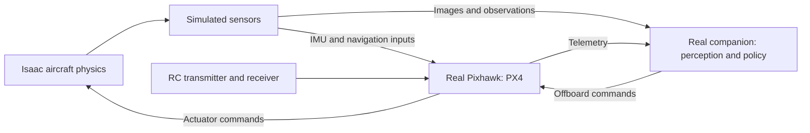

# Pixhawk 6C hardware-in-the-loop overview

Investigation date: 2026-09-26. This document records findings and a proposed
direction. It does not define implemented HIL support or replace the current
runtime, flight-parameter, or alignment contracts.

Adding the Pixhawk 6C to Isaac Sim through hardware-in-the-loop (HIL) is a sound
next validation step. Two distinctions guide the work: HIL measures a real
controller operating a simulated aircraft, and comparing PX4 SITL with HIL is a
different task from fitting the lightweight training controller.

| Environment | Flight controller | Aircraft, motors, and sensor inputs | Main purpose |
| --- | --- | --- | --- |
| Isaac Lab training | Lightweight controller model | Simulated | Fast policy training |
| PX4 SITL with Isaac | PX4 running on the computer | Simulated | Software integration and reference behavior |
| Pixhawk HIL with Isaac | PX4 running on the Pixhawk | Simulated | Embedded execution, timing, and integration |
| Physical flight | PX4 running on the Pixhawk | Physical | Validate actual aircraft behavior |

PX4 supports external HIL through simulated sensor inputs and returned actuator
commands. Some normal hardware paths are bypassed in HIL, so it provides
complementary coverage to SITL.
[PX4 HIL documentation](https://docs.px4.io/main/en/simulation/hitl)

**What HIL flight parameters would measure.** Hover and controller-response
evidence collected through the Pixhawk would characterize the selected PX4
firmware and configuration, running on that board, connected through the HIL
interface to the Isaac aircraft model. The measured behavior belongs to this
complete setup; it is not an intrinsic flight characteristic of a Pixhawk 6C.

This evidence can expose differences in controller execution, scheduling, and
communication, and their effect on closed-loop behavior. It does not identify
the physical aircraft's actual thrust curve, motor response, aerodynamics,
vibration, or sensor errors. Those require physical measurements. Replacing
SITL with a hardware controller leaves the aircraft and sensor models simulated.

HIL should therefore become an additional flight-parameter source. Retain
separately identified SITL, HIL, and eventually physical-flight datasets. HIL
measurements must not silently replace or relabel existing SITL evidence.

The current [flight-parameter workflow](FLIGHT_PARAMETERS.md) already provides
immutable evidence, firmware information, independent fitting, validation, and
acceptance flights, and explicit provenance. Its
[configuration](../configs/flight/holybro_x500_v2_suite.yaml) currently selects
only SITL with simulator ground truth, and the loader enforces that boundary.
Supporting HIL requires a deliberate extension.

**How alignment should change.** Both controller relationships need validation,
but they serve different purposes:

- SITL versus Pixhawk: establish behavioral equivalence. Match the PX4 source
  version, relevant parameters, airframe configuration, simulated aircraft, and
  command profiles. Investigate discrepancies in scheduling, transport, sensor
  injection, or configuration. Independently tuning SITL gains to conceal such
  discrepancies would weaken its value as a representation of deployment.
- Lightweight controller versus PX4: retain model fitting. The lightweight
  controller approximates PX4 for efficient training. It should reproduce the
  deployment-relevant response, including material delays and limits.

The recommended starting point is to validate SITL against HIL. If they agree
sufficiently for the intended tasks, retain SITL as the convenient fitting
reference and use HIL as an independent qualification gate. If HIL exposes
meaningful, repeatable differences, incorporate those into the training model
and validate against HIL evidence. Separate deployment behavior from artifacts
of the HIL connection before deciding what to model.

This extends the current [alignment architecture](SIM_TO_SIM_ALIGNMENT.md)
without immediately introducing two independent fitting pipelines. Controller
gains must not absorb errors that belong to the simulated aircraft or transport.

The lightweight controller and learned policy are separate components. The
controller supplies training dynamics; deployment sends policy commands to PX4.
Adding a Pixhawk does not itself move policy inference onto that board. The
intended inference computer remains part of the deployment architecture to
qualify. See the [policy deployment contract](RL_WORKFLOW.md#deployment).

**Implementation scope.** The work has five main parts:

1. Establish hardware compatibility. Confirm a suitable PX4 firmware build,
   HIL support, and aircraft configuration on the Pixhawk. PX4 describes external
   HIL as community-maintained and warns that compatibility can vary with
   release. Its documented integrations cover jMAVSim and Gazebo Classic; Isaac
   would require project integration work. A firmware build with the necessary
   simulation modules may be needed.
   [PX4 HIL support and setup](https://docs.px4.io/main/en/simulation/hitl)
2. Add a hardware connection and lifecycle. Extend the bridge to communicate
   with the board, expose the device to the relevant container, route commands
   and telemetry, and manage connection loss, resets, and log retrieval. Isaac
   and ROS can remain containerized; the board takes over PX4 execution for the
   HIL vehicle.
3. Establish reliable real-time operation. The current bridge assumes TCP
   lockstep, where simulation progress waits for PX4. Hardware HIL needs a
   real-time exchange with measured latency, jitter, and missed deadlines.
   Isaac must sustain the required cadence under the intended workload. This
   timing change is the largest architectural difference, and requires more
   than changing a connection address.
   [Current bridge contract](../isaac/runtime/extensions/px4_sitl_brigde/docs/PX4_BRIDGE_CONTRACTS.md#lockstep-semantics),
   [industrial HIL workflow](https://www.mathworks.com/help/simscape/real-time-simulation.html)
4. Extend evidence collection and comparison. Reuse the existing maneuvers and
   analysis while adding board identity, firmware and configuration provenance,
   synchronized timing, and hardware logs. Review assumptions about fresh
   processes, exact sample cadence, and controller-state replay. Preserve raw
   evidence and independent dataset splits. One board makes hardware trials
   sequential; simulator seeds alone cannot guarantee repeatable hardware
   scheduling.
5. Qualify the complete deployment path. Exercise the policy command interface,
   intended inference computer, state-estimation inputs, and failure behavior.
   Simulator ground truth remains useful for measurement. Successful control
   with perfect observations does not validate the eventual perception and
   estimation system.

The existing measurement and alignment boundaries are useful foundations. The
main implementation uncertainties are firmware compatibility, real-time
simulation performance, and whether hardware logging supplies the state needed
by the current replay checks. An initial feasibility experiment should resolve
these before committing to a larger workflow redesign.

**Relationship to industry and research practice.** HIL is an established way
to test embedded controllers against simulated physical systems before testing
the complete machine. Reliable real-time behavior and a representative physical
model are central to that practice.
[MathWorks HIL overview](https://www.mathworks.com/discovery/hardware-in-the-loop-hil.html)

Successful sim-to-real flight research also addresses physical dynamics and
observation errors using real measurements. For example, Swift combined
simulation training with real-flight data to model dynamics and perception
discrepancies. This supports retaining physical characterization as a separate
part of the workflow; HIL cannot supply evidence about physical effects that
remain simulated.
[Kaufmann et al., Nature 2023](https://rpg.ifi.uzh.ch/docs/Nature23_Kaufmann.pdf)

The recommended progression for this project is fast training and SITL
validation, followed by Pixhawk HIL qualification, physical bench
characterization and controlled flights, and model updates based on measured
discrepancies. HIL can be the last simulation gate before flight. Physical
measurements should subsequently improve the simulation layers, making this an
iterative process rather than a one-way sequence.

**First milestone.** Demonstrate one Pixhawk-controlled hover and response
experiment in Isaac, compare it with the same SITL experiment, and record timing
and firmware/configuration evidence. This establishes whether HIL exposes a
meaningful gap before expanding the alignment architecture. It is a feasibility
milestone, not sufficient evidence by itself for controller qualification or
physical flight readiness.

**HIL purpose and scope beyond the flight controller.** The main purpose of HIL
is to verify actual hardware running its intended software against a simulated
environment. Repeatable normal-operation and failure scenarios help expose
processor overload, scheduling delays, communication problems, and recovery
behavior. Response characterization is useful, but system verification and
integration are the primary objectives.
[NI HIL overview](https://www.ni.com/en/solutions/transportation/hardware-in-the-loop/what-is-hardware-in-the-loop-.html)

The flight controller is one possible participant. A companion computer can
receive simulated images and observations, run perception and policy inference,
and return commands. A real RC receiver or telemetry link can carry commands
and feedback for the simulated aircraft. NVIDIA explicitly describes feeding
Isaac camera data through ROS 2 to a Jetson running computer vision.
[Isaac reference architecture](https://docs.isaacsim.omniverse.nvidia.com/4.2.0/isaac_sim_reference_architecture.html)

Physical sensors and actuators can also participate, with appropriate test
equipment. A GNSS simulator can generate radio-frequency signals representing
simulated motion for a physical receiver. Actuators and propulsion electronics
need suitable load or measurement fixtures to exchange physical responses with
the simulation. Larger aerospace rigs combine real and simulated subsystems in
this way.
[GNSS HIL signal generation](https://www.spirent.com/blogs/hardware-in-the-loop-faithful-reproduction-of-motion-data-is-key-to-testing),
[aerospace test rigs](https://www.ni.com/en/solutions/aerospace-defense/case-studies/iron-bird-test-systems-help-advance-turkiyes-aerospace-programs.html)

The injection point determines the coverage. Streaming simulated images into a
Jetson exercises its computing hardware and perception software, but not a
physical camera's optics or image sensor. Injecting simulated IMU readings into
PX4 does not exercise the Pixhawk's physical accelerometers. A closed loop also
requires hardware outputs to change the simulation and therefore subsequent
inputs. Recording playback and standalone hardware characterization remain
useful tests, but they do not provide that feedback.

**Recommended equipment for this project.** Build toward a bench containing
the existing Pixhawk 6C, the intended onboard computer, and a real RC link. Keep
aircraft physics and sensor generation in Isaac initially. The first milestone
above needs only the existing workstation, Pixhawk, connection, and logging;
add the companion and RC path as their integration becomes ready.

| Priority | Equipment | Project purpose |
| --- | --- | --- |
| Start now | Existing GPU workstation running Isaac | Simulate aircraft, motors, environment, and sensors; record reference motion |
| Start now | Existing Pixhawk 6C with a suitable microSD card | Run PX4 and retain onboard ULogs for comparison with SITL |
| Start now | Reliable USB data cable and appropriate board power | Establish the simulator connection and repeatable bench operation |
| Next | Intended companion computer with storage, cooling, and specified power supply | Exercise policy execution, commanding, and eventually perception under actual computing constraints |
| Next | PX4-compatible RC transmitter and receiver | Exercise manual intervention, mode changes, and receiver-loss handling independently of the companion |
| With the companion | Ethernet connection to the workstation, plus a suitable Pixhawk serial interface and cable | Stream simulated observations and exercise the intended companion-to-PX4 command path |

PX4 provides onboard logging and companion connections through its telemetry
interfaces. A 3.3 V TTL USB-to-UART adapter with the appropriate JST-GH cable is a
practical bench option; select it against the board's documented port
specifications. The Ethernet connection in this proposal is between the
workstation and companion. The Pixhawk connection uses its supported USB or
serial interfaces.
[PX4 companion setup](https://docs.px4.io/main/en/companion_computer/pixhawk_companion),
[Pixhawk 6C ports](https://docs.holybro.com/autopilot/pixhawk-6c/pixhawk-6c-ports),
[PX4 logging](https://docs.px4.io/main/en/dev_log/logging)

The starting companion candidate is a Jetson Orin Nano Super 8 GB developer kit
with NVMe storage and its supplied power adapter. This is a bench-development
recommendation. The eventual flight carrier, cooling, power, and mounting still
need qualification, along with a compatible JetPack, ROS, and inference stack.
Use current vendor requirements when selecting storage and power components.
[NVIDIA setup guide](https://docs.nvidia.com/jetson/orin-nano-devkit/user-guide/latest/quick_start.html)

The reason to consider a Jetson is the eventual visual localization and switch
perception workload alongside ROS and policy execution. The current
low-dimensional policy alone does not establish a need for GPU acceleration.
Profile the intended perception workload, memory use, and worst-case inference
latency before choosing a larger computer or claiming this candidate is
sufficient. The [archived hardware BOM](archive/HOLYBRO_X8_STAGED_BOM_v2.md)
proposes the same Jetson family, but its performance, software, price, and power
assumptions are historical. It does not establish current equipment ownership.

Choose the RC transmitter and receiver intended for physical flight, with
accessible mode and emergency controls, and qualify their behavior in HIL. PX4
documents the supported receiver families and interfaces. This complements the
project's planned independent RC and PX4 recovery paths.
[PX4 radio control systems](https://docs.px4.io/main/en/getting_started/rc_transmitter_receiver),
[hardware flight prerequisites](backlog/safety_harness.md)

The proposed combined loop is:

This is a functional diagram; connection routing and synchronization remain
implementation work. It exercises the autonomy computer and flight controller
together while aircraft motion remains simulated.

**Later equipment for the switch task.** Two physical setups would address
project-specific gaps once the corresponding software is ready:

- A camera and real switch target, after selecting the perception approach.
  Measure pose accuracy, close-range visibility, lighting sensitivity, and
  latency. Isaac-generated images can first exercise perception on the
  companion. Physical sensor providers remain a later milestone in the
  [RL follow-ups](backlog/rl_followups.md#physical-randomization-and-perception).
- An instrumented pusher and switch fixture, measuring compression, contact,
  and activation force. Use it to validate the contact model. A standalone
  fixture provides characterization evidence; it becomes part of HIL when its
  measured response feeds back into the simulated interaction.

Additional LiDAR, navigation-sensor, or propulsion rigs should follow measured
gaps in perception, contact, or aircraft dynamics. The highest-value expansion
after initial Pixhawk capture is the real companion and RC path, exercising the
autonomy software and hardware intended for flight together.
